# jflow

Two things for engineering teams that plan in Linear (Jira next):

- **Team workload board** - every person's own projects and the work they do outside them
  (bugs, support, tech debt, stability) in one place, with a "free in N weeks" forecast.
- **Agent flow** - agent skills that take work from intent to merged PRs, with a human gate at
  every stage. Small outside issues can go straight to the agent with `/flow:quick`.

The skills work as a Claude Code plugin and as Codex skills. Documents (intent, spec, plan,
verification) live in [Jitera](https://jitera.com), so the whole team and its agents share the
same context.

## The flow

| What | Where |
| --- | --- |
| Stage ("folder") | Linear project label `flow:*` |
| Intent, spec, plan, verification, log | one Jitera folder per project, one file per stage, editable by anyone at any time |
| Work items | Linear issues in the project, about one PR each |
| Code | your service repos, as usual |
| Flow skills and commands | this repo |

One Linear project = one problem = one run through the flow. Its issues are only the
breakdown into small pieces, about one PR each. A feature usually spans several repos, so
artifacts do not live in a repo.

```mermaid
flowchart LR
  intent["flow:intent"] -->|human approves| spec["flow:spec"]
  spec -->|agent drafts spec| review["flow:spec-review"]
  review -->|human approves| plan["flow:plan"]
  review -.->|TDR needed| tdr["flow:tdr"]
  tdr -.->|engineer accepts TDR| plan
  plan -->|human approves plan| build["flow:build"]
  build -->|agent opens draft PRs| prs["PRs"]
  prs -->|human reviews, all merged| verify["flow:verify"]
  verify -->|human checks evidence| done["flow:done"]

  classDef agent fill:#e8f0fe,stroke:#4a6fd1
  class spec,build,verify agent
```



Blue stages run without a human (they can run on a runner). Arrows marked "human" are gates.
The dashed path is optional: only when the spec says a TDR is needed.

Day to day you only need one command:

```
/flow:next P-ENG-12      # a project
/flow:next ENG-1234      # or any issue in it
```

It reads the current label and files, asks you to approve the gate if there is one, moves the
label and runs the next stage. Without an ID it takes it from the git branch name. On a
runner it never passes a gate, it only does the agent steps.

**One stage, one session.** Each stage relies on the files, not on the chat before it, so
start it in a fresh context:

- Every stage ends with `Stage done: <stage>` and a reminder to `/clear` (Codex: `/new`).
- In Claude Code a hook stops `/flow:<stage>` in a session that already finished a stage and
  asks for `/clear`. Add `--here` to the command to stay in the session anyway.
- `spec` and `verify` ask no questions, so `/flow:next` runs them in the `flow-spec` and
  `flow-verifier` subagents. They always get a clean context, the same as on a runner, and
  cannot edit local files.

**Build without picking issues by hand.** At `flow:build`, `/flow:next` runs `build` on the
whole project. It takes every ready issue in plan order, builds each one in its own worktree,
commits, pushes and opens a draft PR. Dependent issues are stacked on their dependency's
branch, independent ones run in parallel. Questions go to you in the chat, or, without a human,
to the PR as a comment tagging the owner and to the Linear issue. You review and merge PRs and
approve stages. Run `/flow:next` again to take the next wave.

The skills can also be run directly:

| Skill | Writes | Runs |
| --- | --- | --- |
| `/flow:intent <project>` | `1-intent.md` | with a human, local or in Jitera |
| `/flow:spec <project>` | `2-spec.md` | local or runner |
| `/flow:tdr <project>` | draft TDR, optional | local, with the engineer who owns it |
| `/flow:plan <project>` | `3-plan.md` + Linear issues | local, with a human |
| `/flow:build <project>` | one wave: every ready issue gets a branch, commits and a draft PR (stacked when dependent, parallel when not) | local or runner, asks only when stuck |
| `/flow:verify <project>` | `4-verification.md` | local or runner, read only |
| `/flow:quick <issue>` | one small issue without a project: one-issue folder, PR, review request | local, the human labels the issue first |

`0-status.md` holds a status table of all stages and the log, updated on every run.

Rules every skill follows are in [CONVENTIONS.md](CONVENTIONS.md). File templates are in
[templates/](templates/).

## Quick: hand a small issue to the agent

Outside work is often small: a copy change, a clear bug, a QA finding. At triage a human adds
`agent:ready` and one `repo:<name>` label, sets the assignee to the engineer who will review,
and runs `/flow:quick <issue>`. The agent builds the fix, opens a PR, asks the assignee for a
review and keeps its state in labels (`agent:working`, `agent:review`, `agent:declined`).
The workload board reads the same labels. Details: [skills/quick/SKILL.md](skills/quick/SKILL.md).

## Settings

Defaults work as they are. To change them, add a `## jflow` section to your CLAUDE.md (user,
project or repo level) with any of these lines:

```markdown
## jflow
- Jitera project for flow documents: Flow
- TDR folder: Technical Design Record (TDR)
- Product docs to search for context: <Jitera project names>
- Model route: <route name, if your sessions go through a model gateway>
- Compliance to check in specs and TDRs: <for example ISMAP, SOC 2, HIPAA>
```

## Install

Requirements: `gh` logged in, Linear MCP and Jitera MCP connected.

### Claude Code

```
/plugin marketplace add Jitera-Product/jflow
/plugin install flow@jflow
```

Update later with `/plugin marketplace update jflow`. For local work on the plugin itself:
`claude --plugin-dir <path to jflow>`.

### Codex

```bash
git clone git@github.com:Jitera-Product/jflow.git
jflow/scripts/install-codex.sh
```

The script links every skill into `~/.agents/skills/`. Update with `git pull` (re-run the
script only when a new skill is added).

### How to call the skills

| Claude Code | Codex |
| --- | --- |
| `/flow:next ENG-1234` | `$next ENG-1234` |
| `/flow:intent`, `/flow:spec`, `/flow:tdr`, `/flow:plan`, `/flow:build`, `/flow:verify`, `/flow:quick` | `$intent`, `$spec`, `$tdr`, `$plan`, `$build`, `$verify`, `$quick` |

The plugin prefix `flow:` in Claude Code is optional while no other command has the same name.

## Running on a runner (headless)

```bash
export ANTHROPIC_API_KEY=...          # or your model gateway's base URL and token
claude -p "/flow:spec P-ENG-12" --plugin-dir ./jflow --max-turns 60
```

In headless mode skills never ask questions. They write open questions into the files.

## Layout

```
.claude-plugin/plugin.json       Claude Code plugin manifest (name: flow)
.claude-plugin/marketplace.json  lets this repo be added as a Claude Code marketplace
CONVENTIONS.md                   rules shared by all flow skills
templates/*.md                   templates: 0-status, 1-intent, 2-spec, 3-plan, 4-verification, tdr
skills/<name>/SKILL.md           one skill per stage, plus next and quick
agents/flow-spec.md              subagent for spec, fresh context, no local edits (Claude Code)
agents/flow-verifier.md          subagent for verify, read only (Claude Code)
agents/flow-builder.md           subagent for one issue in its own worktree (Claude Code)
hooks/                           Claude Code hooks: one stage per session, and a Bash guard
                                 (no merge, no force push, no push to main, no destructive infra)
skills/<name>/CONVENTIONS.md     symlinks to the root file and templates/, so skills work in
skills/<name>/templates          Claude Code and Codex
scripts/install-codex.sh         links skills into ~/.agents/skills for Codex
board/                           team workload board (Cloudflare Worker + React)
```

Skills never use Claude-only features (`${CLAUDE_PLUGIN_ROOT}`, `!` commands). Shared files
are reached through symlinks next to each SKILL.md. Keep it that way so both agents work.

## Team workload board

A Cloudflare Worker app in [board/](board/README.md). Setup, access and deploy are described
there.

## Not done yet

- Jira support.
- Runner triggers (Linear label change -> GitHub Action). Start manually first.
